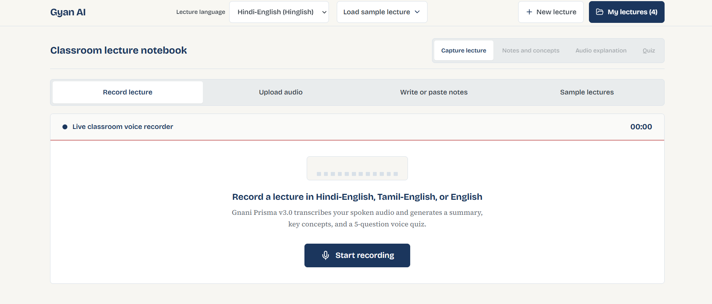
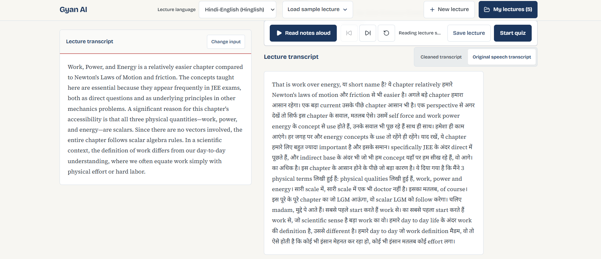
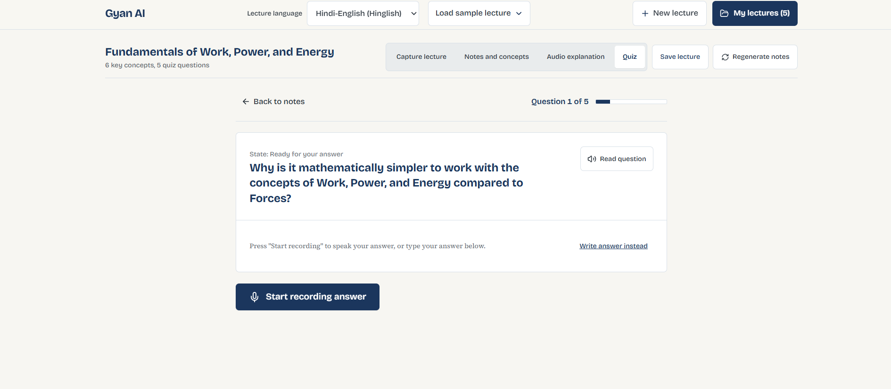
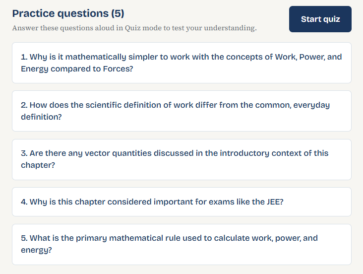
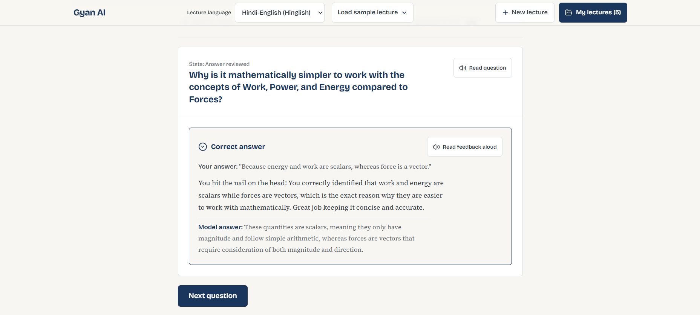
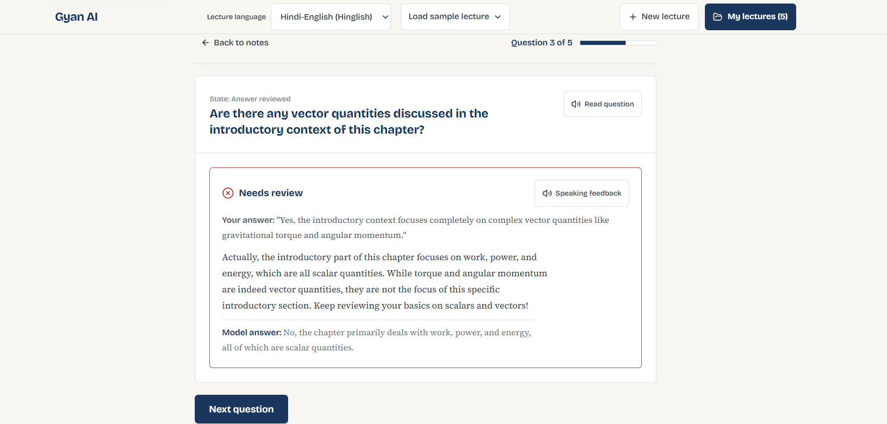
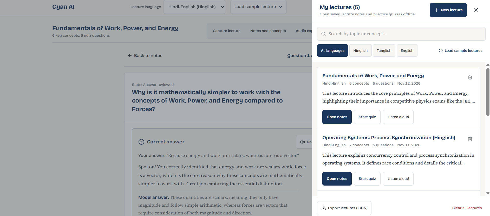

# Gyan AI

**Record your lecture. Revise it by voice. Quiz yourself out loud.**

Gyan AI is a voice tutor for code-mixed classrooms. It listens to a recorded lecture in English, Hinglish (Hindi-English) or Tanglish (Tamil-English), then teaches the material back through spoken explanations and an interactive voice quiz. Built for the Great Indian AI Internship Challenge by Gnani AI.

[One-page pitch](PITCH.pdf)

## See it in action

<table>
  <tr>
    <td width="50%"><br><sub><b>1. Capture.</b> Record in the browser or upload audio, and pick the class language.</sub></td>
    <td width="50%"><br><sub><b>2. Two transcripts.</b> The original from Prisma and a version corrected using context.</sub></td>
  </tr>
  <tr>
    <td width="50%"><br><sub><b>3. Voice quiz.</b> The question is spoken and you answer out loud.</sub></td>
    <td width="50%"><br><sub><b>4. Listen.</b> The summary and key concepts read aloud by Timbre.</sub></td>
  </tr>
</table>

---

## Architecture & Features

1. **Lecture Audio Ingestion**
   - **Live Recording**: Built-in browser `MediaRecorder` with live audio waveform meters, elapsed timers, and automatic 30-60 second chunking with progressive transcript stitching.
   - **Audio File Upload**: Upload audio recordings in WebM, Opus, MP3, WAV, or M4A format.
   - **ffmpeg Audio Conversion**: Automatically normalizes browser WebM/Opus audio to 16kHz 16-bit mono PCM WAV for the Gnani Prisma STT engine.

2. **Speech-to-Text (STT) via Gnani Prisma API**
   - Supports English (`en-IN`), Hindi-English code-mixed (`hi-IN`), and Tamil-English code-mixed (`ta-IN`).
   - Handles multi-chunk audio uploads and streams stitched partial transcripts as chunks finish.

3. **LLM Engine (`llm_client.py`)**
   - This submission uses **Gemini** for the LLM step. Gnani Evon (open weights on Hugging Face) was not used; `.env.example` includes optional settings for an Evon endpoint (`HF_TOKEN`, `EVON_API_URL`) that I did not run for this submission.
   - Turns the raw transcript into structured output with a fixed JSON schema:
     - `clean_transcript`: readable text that corrects filler words and speech-recognition errors while preserving domain terms. The original transcript is kept next to it.
     - `summary`: a 2-4 sentence overview.
     - `concepts`: key concepts with one-line explanations.
     - `questions`: practice questions with model answers.
   - Automatic 1-retry with a corrective prompt if the JSON is invalid.

<p align="center">
  
  <br><sub>Practice questions generated from the lecture, ready for Quiz mode.</sub>
</p>

4. **Text-to-Speech (TTS) via Gnani Timbre API ("Explain Mode")**
   - Reads the summary and key concepts aloud.

5. **Interactive Voice Quiz Loop ("Quiz Mode")**
   - Gyan AI speaks each question aloud using Timbre TTS.
   - The student speaks their answer, and Gnani Prisma transcribes it.
   - The LLM judges the answer (`correct`, `partial`, or `wrong`) and writes 2-3 sentences explaining the gap in an encouraging tone.
   - Timbre reads the feedback aloud.
   - Shows progress, correct count and a final score summary.

<table>
  <tr>
    <td width="50%"><br><sub><b>Correct answer.</b> Confirmed and reinforced.</sub></td>
    <td width="50%"><br><sub><b>Incorrect answer.</b> The gap is explained, aloud and on screen.</sub></td>
  </tr>
</table>

6. **"My Lectures" Library**
   - Automatic local persistence in browser `localStorage` under `gyan_ai_saved_lectures`.
   - Every recorded lecture, transcript, summary and quiz is saved with timestamps, word counts and language metadata.
   - Search by topic or concept, filter by language (Hinglish, Tanglish, English), export sessions as JSON, and jump straight into the quiz or concept study.
   - Three built-in code-mixed sample lectures, so the full flow can be tried without a microphone.

<p align="center">
  
  <br><sub>Saved lectures on your own device, searchable and filterable by language.</sub>
</p>

---

## Project Structure

```
├── .env.example              # Environment variables template
├── gnani_client.py           # Gnani Prisma STT & Timbre TTS client + ffmpeg conversion
├── llm_client.py             # LLM analysis & voice quiz judging with JSON validation
├── main.py                   # FastAPI backend implementation
├── requirements.txt          # Python dependencies
├── server.ts                 # Node/Express server with Vite middleware & APIs
├── test_cases.json           # 3 sample code-mixed lecture test cases
├── src/
│   ├── App.tsx               # Main UI with tabs, audio recorder and quiz
│   ├── components/           # AudioRecorder, ExplainMode, QuizMode, TestCases, Navbar
│   ├── types.ts              # TypeScript interfaces
│   └── main.tsx              # React entry point
└── package.json              # Web dependencies
```

---

## Prerequisites

1. **ffmpeg**: converts browser WebM/Opus audio to 16kHz PCM WAV.
   - **Ubuntu/Debian**: `sudo apt update && sudo apt install -y ffmpeg`
   - **macOS**: `brew install ffmpeg`
   - **Windows**: `winget install Gyan.FFmpeg` or download from [ffmpeg.org](https://ffmpeg.org).
2. **Node.js** (v18+) and **Python** (3.10+).

---

## Configuration (`.env`)

Copy `.env.example` to `.env`:

```bash
cp .env.example .env
```

Fill in your credentials (never commit real values):

```ini
# Gnani.ai API key for Prisma STT and Timbre TTS
GNANI_API_KEY="your-gnani-api-key"
GNANI_STT_URL="https://asr.gnani.ai/v1/recognize"
GNANI_TTS_URL="https://tts.gnani.ai/v1/synthesize"

# LLM used in this submission
GEMINI_API_KEY="your-gemini-api-key"

# Optional, not used in this submission: Gnani Evon endpoint
HF_TOKEN=""
EVON_API_URL=""
USE_LOCAL_EVON="false"

PORT=3000
```

> **Note on fallbacks**: if no API key is configured, the app falls back to sample data so every screen can still be tested. Add your keys to use the real Gnani models.

---

## Running the Application

### Option 1: Integrated full-stack server (recommended)

```bash
npm install
npm run dev
```

Open `http://localhost:3000`.

### Option 2: Standalone FastAPI backend + frontend

1. Start the Python backend:
   ```bash
   python3 -m venv venv
   source venv/bin/activate
   pip install -r requirements.txt
   uvicorn main:app --host 0.0.0.0 --port 8000 --reload
   ```
2. Start the frontend:
   ```bash
   npm run dev
   ```

---

## Microphone Security Note

> Browsers only allow microphone access on **`localhost`** or **HTTPS**. Over a plain remote IP address, audio file upload still works.

---

## Verification Pipeline: 4-Stage Test Plan

1. **Record / Upload to Prisma transcript**: choose Hindi-English, Tamil-English or English, then record or upload. A chunking indicator shows the 30-60 second slices, and the stitched transcript appears as chunks finish.
2. **LLM analysis**: generates the clean transcript, summary, concepts and practice questions.
3. **Timbre readout (Explain Mode)**: plays the summary and each key concept aloud.
4. **Voice quiz (Quiz Mode)**: the question is spoken, you answer by voice, the answer is judged and explained aloud, and you get a final score.

## Sample Lectures Included

No microphone? Load any of the 3 built-in code-mixed lectures:
1. **Operating Systems: Process Synchronization** (Hinglish)
2. **Machine Learning: Gradient Descent** (Tanglish)
3. **Data Structures: Contiguous Memory & Big-O** (Indian English)

---

## Known Limitations

- **No accounts.** Lectures are stored in the browser (localStorage) on your own device only.
- **Gemini free-tier rate limits** can slow or fail requests during heavy use.
- **Not publicly deployed**, to protect API credits. Run it locally with your own keys.
